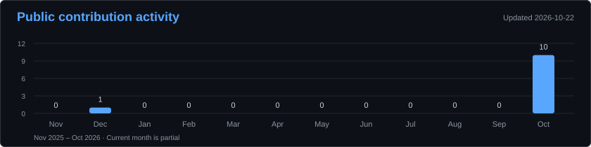

<h1 align="center">Hi, I'm Lucas Betioli 👋</h1>
<h3 align="center">AI Engineer at Alliage · Computer Vision & Medical AI</h3>

  <a href="mailto:lucasantoniobetioli@usp.br">Email</a> ·
  <a href="https://orcid.org/0009-0003-7282-9088">ORCID</a> ·
  <a href="https://poligome.com">Poligome</a>

## About me

- 🎓 **M.Sc. in Applied Physics to Medicine and Biology** — USP, 2025.
- 🎓 **B.Sc. in Medical Physics** — USP, 2023.
- 🌍 **Google Summer of Code mentor** for [InVesalius](https://github.com/invesalius/invesalius3).
- 🧠 Research in **machine learning, tractography and TMS motor responsiveness**.

## Tech stack

| | Technologies |
| :--- | :--- |
| **Languages** |  |
| **AI, GPU & visualization** |    |
| **Backend & cloud** |  |

## Projects & open source

| Project | My involvement |
| :--- | :--- |
| [**Poligome ↗**](https://poligome.com) | Helping build AI-assisted image annotation. |
| [**InVesalius ↗**](https://github.com/invesalius/invesalius3) | GSoC mentoring in medical image segmentation and neuronavigation. |

## GitHub stats

  
  

