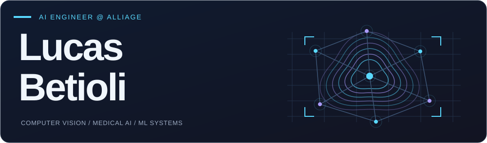
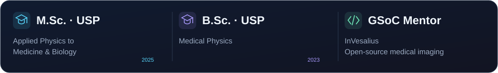
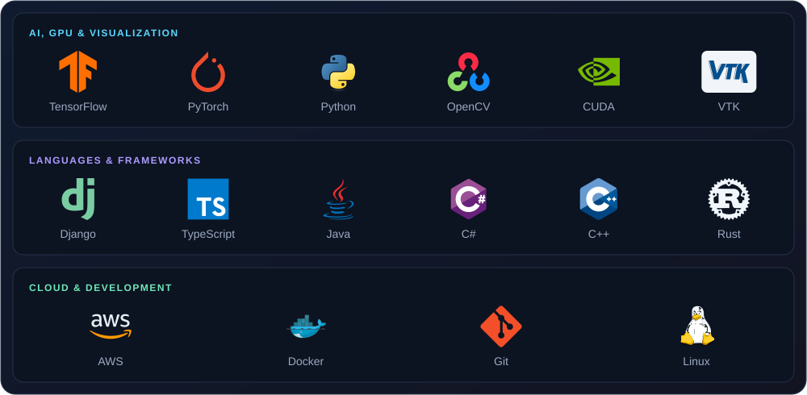
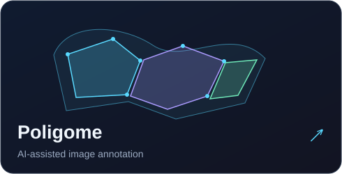
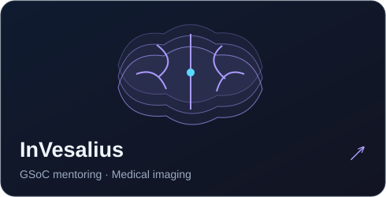
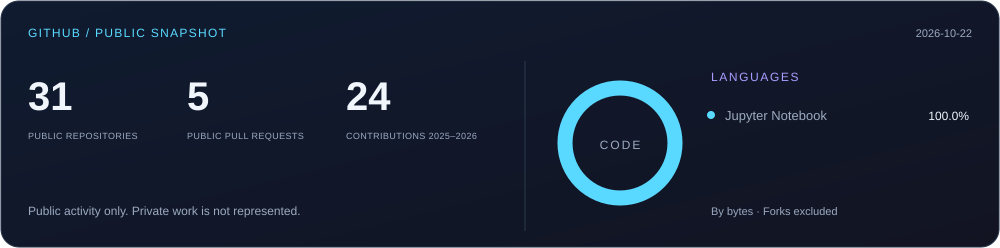
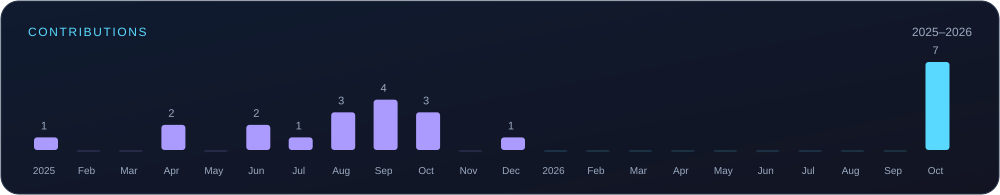

  <a href="https://poligome.com"><b>Poligome ↗</b></a> &nbsp; · &nbsp;
  <a href="https://orcid.org/0009-0003-7282-9088"><b>Research ↗</b></a> &nbsp; · &nbsp;
  <a href="mailto:lucasantoniobetioli@usp.br"><b>Let’s connect ↗</b></a>

### AI · GPU · Languages

### Building & contributing

### GitHub

Public data snapshot · Language shares measure repository bytes, not proficiency · Forks excluded from language totals.

<b>A little more about my research</b>

My master’s research at the University of São Paulo explored machine learning with tractography-derived information to predict motor responses to transcranial magnetic stimulation.

I work across computer vision, medical imaging, and ML systems. I also mentor Google Summer of Code projects with InVesalius and help build [Poligome](https://poligome.com).

<!-- Technology logos: Devicon, MIT license. See assets/devicon-LICENSE.txt. -->
