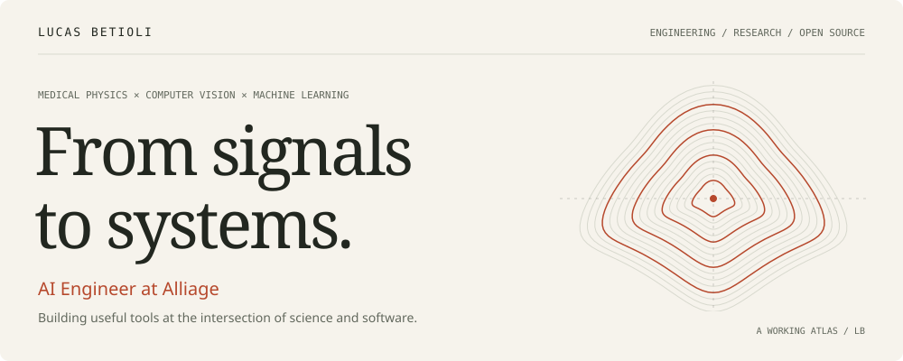
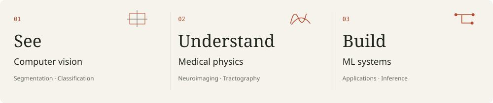
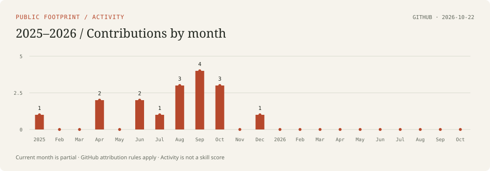
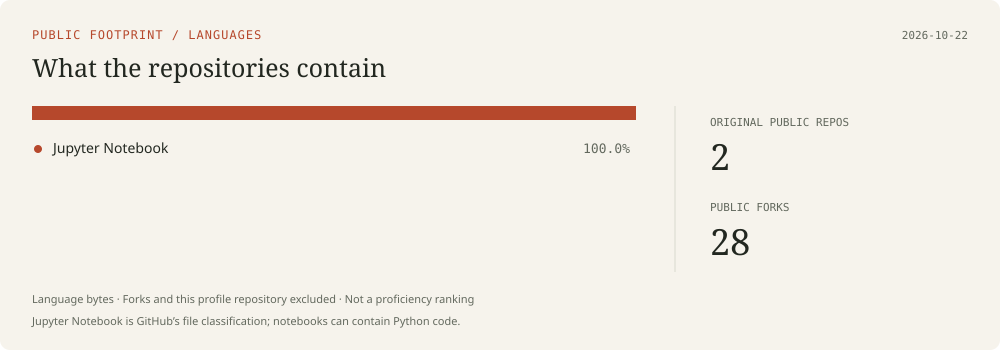

<picture>
  <source media="(prefers-color-scheme: dark)" srcset="assets/hero-dark.svg">
  
</picture>

[Poligome ↗](https://poligome.com) &nbsp; / &nbsp; [Research identity ↗](https://orcid.org/0009-0003-7282-9088) &nbsp; / &nbsp; [Get in touch ↗](mailto:lucasantoniobetioli@usp.br)

I’m **Lucas dos Santos Betioli**, an **AI Engineer at Alliage** with a background in medical physics. I work across computer vision, medical imaging, and the software that turns models into usable tools.

My work starts with a scientific question and continues through the details of building: data, evaluation, interfaces, inference, and deployment. I care about understanding what a model learns and making its behavior useful to the people who use it.

## 01 / A working atlas

<picture>
  <source media="(prefers-color-scheme: dark)" srcset="assets/atlas-dark.svg">
  
</picture>

| Area | What I work with |
| :--- | :--- |
| **Computer vision** | Image segmentation and classification, 2D and 3D medical images, annotation workflows |
| **Scientific ML** | Neuroimaging, diffusion MRI, tractography, transcranial magnetic stimulation, experimental evaluation |
| **AI engineering** | Model inference, Python applications, APIs, cloud deployment, practical user workflows |

## 02 / Selected work

### Poligome

**Making image annotation easier to work with.**

I help build Poligome, a computer vision annotation tool. My interests here include AI-assisted segmentation, usable annotation workflows, and moving from model output to datasets people can actually train with.

[Explore Poligome →](https://poligome.com)

### InVesalius · Google Summer of Code

**Contributing to the people and software behind medical imaging.**

I have mentored Google Summer of Code projects with InVesalius, supporting work in brain segmentation and neuronavigation. I enjoy the part of open source where research ideas become maintainable software through review, discussion, and iteration.

[InVesalius →](https://github.com/invesalius/invesalius3) &nbsp; · &nbsp; [GSoC projects →](https://github.com/invesalius/gsoc)

### Research · Brain structure and stimulation

**Connecting neuroimaging to motor responsiveness.**

My master’s research explored machine learning with tractography-derived information to predict motor responses to transcranial magnetic stimulation. This work shaped how I think about small datasets, meaningful validation, and the gap between a promising result and a reliable model.

[Research identity →](https://orcid.org/0009-0003-7282-9088)

## 03 / Background

| | Qualification |
| :--- | :--- |
| **Industry** | AI Engineer · **Alliage** |
| **M.Sc. · 2025** | Applied Physics to Medicine and Biology · **University of São Paulo** |
| **B.Sc. · 2023** | Medical Physics · **University of São Paulo** |
| **Open source** | Google Summer of Code mentor · **InVesalius** |

## 04 / Tools I reach for

| Layer | Languages & tools |
| :--- | :--- |
| **Modeling & experiments** | Python · PyTorch · TensorFlow · Jupyter |
| **Vision & scientific computing** | NumPy · OpenCV · medical imaging and tractography workflows |
| **Applications & delivery** | Django · APIs · AWS · Docker · Git · Linux |

## 05 / Public code, in context

<picture>
  <source media="(prefers-color-scheme: dark)" srcset="assets/activity-dark.svg">
  
</picture>

<picture>
  <source media="(prefers-color-scheme: dark)" srcset="assets/languages-dark.svg">
  
</picture>

Charts refresh daily after GitHub Actions is enabled. Language shares describe repository bytes, not proficiency. Forks are excluded from the language chart. Contributions follow GitHub’s visibility and attribution rules; professional work and shared projects are only partially represented here.

---

**Interested in computer vision, medical AI, or open-source tools?**  
[Let’s talk →](mailto:lucasantoniobetioli@usp.br)

Lucas dos Santos Betioli · Brazil · Physics, models, and the systems around them.
